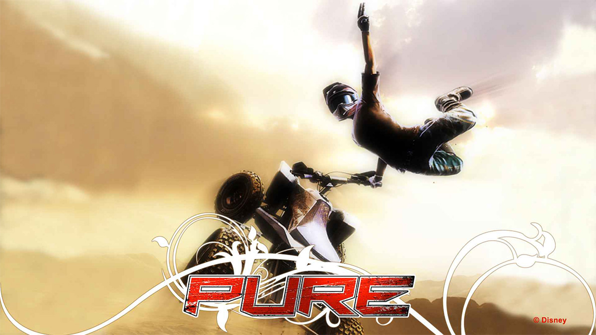

  

# pure-nx

A Nintendo Switch port of **Pure** (Xbox 360, 2008) by static recompilation with
[ReXGlue](https://github.com/rexglue), drawn through Renut's Direct3D-level renderer on deko3d.

**No game files are included.** You need your own legally obtained copy of Pure (Xbox 360). This repository holds
only the port's source code; the recompiled code (`generated/`) and the shader packages (`switch_shaders/`) are made
from your copy of the game on your machine.

## Installing (players)

1. Copy `pure.nro` (from Releases) to `sdmc:/switch/pure-nx/`.
2. Copy your extracted game (the folder with `default.xex`) to `sdmc:/switch/pure-nx/game_root/`.
3. Optional, but **recommended**: **four cores**: create a forwarder of `pure.nro` with Sphaira ("Install Forwarder") and start the game
   from it twice. On the first start Pure writes `sdmc:/atmosphere/contents/<forwarder id>/exefs/main.npdm` (an NPDM
   that grants core 3); it never writes one for a retail title's id.

## Status

- Full races with bots, 480p internal resolution, FSR-style upscale to the screen.
- 25-30 fps in races with a CPU and RAM overclock (measured on CPU ~1785 MHz, RAM ~1700). At stock clocks (1020 MHz) races run at ~17-20 fps: the
  game's CPU work is the limit, not the GPU. I've spent several days trying to minimize the CPU bottleneck and for now I've hit the ceiling.
- Using 4 CPU cores is **recommended** (launched through a Sphaira forwarder, see below).

The first start compiles a few shaders (short pauses); they are cached in `sdmc:/switch/pure-nx/`.

**Shader pack.** Put `pipeline_list.bin` from the release next to `pure.nro` (`sdmc:/switch/pure-nx/`). On the first
start the console compiles every shader in that list in the background while you are in the menus (a few minutes; wait
in the menus for smooth races). The results are kept in `deko3d_shaders.bin`; don't delete it. Anything not in the list
compiles once when first drawn (a short pause). Packs from several consoles merge with `tools/merge_shader_cache.py`.

## Settings

`sdmc:/switch/pure-nx/pure.toml` is written on the first start; any key there overrides the build's defaults
(`pure_switch_defaults.toml`):

| Key | Default | |
|---|---|---|
| `pure_fsr` | `true` | FSR-style edge-adaptive upscale with sharpening; `false` = bilinear |
| `pure_fsr_sharpness` | `0.3` | 0.0-2.0, read at start |
| `renut_resolution` | `"480p"` | internal resolution: `480p`, `720p`, `1080p` |
| `input_controller_applet_shortcut` | `false` | `true`: L+R+ZR opens the Switch controller menu (second controller, split Joy-Cons) |
| `[input_p1]` `a`, `b`, ... `rt` | | controls: the Switch buttons for each Xbox button (examples in `pure.toml`) |
| `input_xbox_layout` | `true` | face buttons by position (Xbox layout); `false` = by letter |
| `log_to_file` | `true` | logs in `sdmc:/switch/pure-nx/logs/` |

## Support
Making ports consumes a lot of my time, and Claude tokens (lol)  
Every contribution helps cover development costs, and to roll out ports faster.
Thanks for supporting my work!
[BuyMeACoffee](https://buymeacoffee.com/czn999)

## Building (Windows)

Needs devkitPro (devkitA64, libnx, switch-zstd), Visual Studio with C++, its CMake and Ninja and Clang tools, Python 3
and git. Everything else is in this repository (Renut's third-party code: `tools/rexglue-sdk-pure/app/thirdparty`).

0. `setup.cmd` - once: fetches the SDK's third-party sources, builds `rexglue.exe` and runs step 1. Put your
   extracted game (with `default.xex`) in `game_root\` first.
1. `codegen.cmd` - recompiles `default.xex` (path in `pure_manifest.toml`) into `generated/default`.
2. Shaders, made from your copy of the game (never shipped here): `python tools\switch_shaders\extract_ark.py
   renut_shaders <game folder>\*.ark` gives `renut_shaders\`; then on Linux (WSL works)
   `tools/switch_shaders/make_switch_shaders.sh tools/rexglue-sdk-pure <XenosRecomp> <spirv-cross> <uam> <zstd>
   renut_shaders switch_shaders` (requirements in the script's header). Players do not need any of this: the
   released `pure.nro` has them.
3. `build_switch.cmd` - builds `out\nx\pure.nro`; the release build is `build_switch_pgo.cmd use` (PGO + LTO, needs
   a `pgo\` profile; output `out\nx_pgo_use\pure.nro`).
4. `package_switch.cmd [drive]` - the SD card folder.

## License

GPL-3.0 (`LICENSE`), as the sa2-nx / banjo-nx code it is built on. Third-party parts keep their licenses
(`tools/rexglue-sdk-pure/THIRD_PARTY_NOTICES.md`). Pure is a trademark of its owners; this project is not affiliated
with or endorsed by them.
